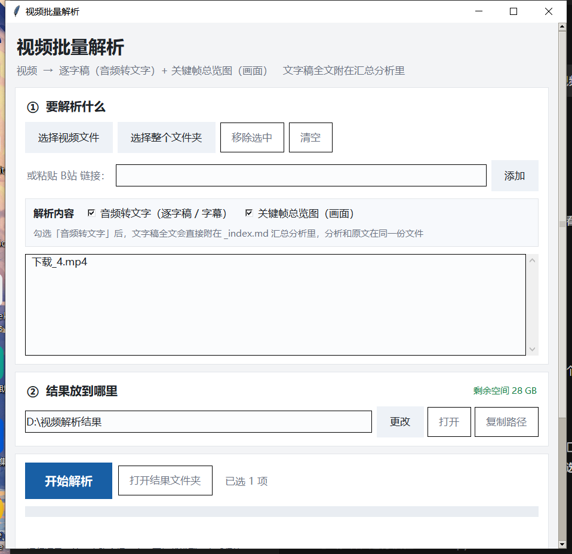

# 视频批量解析 · Video Batch Insight

一个**完全跑在本机**的 Windows 小工具：把一堆视频（或 B 站链接 / 某个 UP 主的投稿）批量拆成可用的知识素材 —— **逐字稿 + 关键帧总览图 + 附带文字稿全文的汇总分析**。不上传视频、不调云端 API、不用一条条拖进度条做笔记。



## 它解决什么问题

一条讲解类视频里的信息有两个通道，只取一个就丢一半：

| 通道 | 拿到什么 | 怎么拿 |
|---|---|---|
| 音频 | 他**说了**什么 | 本地 faster-whisper 转写成逐字稿 |
| 画面 | 屏幕上**写了**什么（PPT / 图表 / 板书 / 界面文案） | 差异检测抽关键帧，拼成总览图 |

课程、分享、教程类视频里，PPT 上的信息密度常常比口播还高，只做音频转文字等于扔掉一半内容；而几十个视频人工整理又慢得离谱。这个工具把两路提取自动化，并把**文字稿全文直接附进 `_index.md` 汇总分析**——打开一份文件，分析表和原文都在里面。

## 主要功能

- **图形界面**（Windows，双击即用）：选视频文件 / 整个文件夹 / 粘贴 B 站链接，点「开始解析」。
- **「解析内容」两个勾选项**，默认都开：
  - ☑ **音频转文字** —— 转写并把文字稿全文附进汇总分析
  - ☑ **关键帧总览图** —— 抽帧拼图
  
  只想要文字稿就只勾第一项，只想要画面就只勾第二项；两项都不勾会直接拦下。
- **本地 GPU 转写**：faster-whisper（`large-v3`，CUDA/float16），无 GPU 自动回退 CPU；产出带时间戳的 `.md`、标准 `.srt`、`segments.json`。
- **画面通道**：纯图像算法选关键帧，拼成适合多模态模型阅读的总览图（每张 ≤12 格、≤4 列、宽 ≤2400px），不调模型、不联网。
- **B 站**：支持单条链接、UP 主主页批量拉取；视频本身有 CC 字幕时优先使用，比 ASR 准。
- **工程细节**：断点续跑（已完成的自动跳过）、后台独立进程（关掉界面任务照跑）、进度条与剩余时间估算、磁盘空间预检、结构化日志协议。

## 工作流程

```
素材（本地文件 / 文件夹 / B站链接）
   ├─ ① 转写：ffmpeg 解 16k 单声道 PCM → faster-whisper → transcript.md / .srt / segments.json
   ├─ ② 抽帧：差异检测 → 关键帧 → overview_01.jpg … → keyframes.json
   └─ ③ 汇总：_index.md（汇总表 + 「文字稿全文」章节，每个视频一节）
```

第 ③ 步之后，还可以把 `transcript.md` 和总览图交给多模态模型，融合成结构化笔记（章节 / 时间轴 / 要点 / 金句）——这一步由人 / 模型来做，工具不假装替你完成。

## 产出文件

| 文件 | 内容 |
|---|---|
| `_index.md` | **汇总分析**：视频清单（时长 / 字数 / 关键帧数 / 总览图数）+ 勾选「音频转文字」时的文字稿全文 |
| `<视频名>/transcript.md` | 段落化逐字稿，每段带 `[mm:ss]` |
| `<视频名>/transcript.srt` | 标准字幕 |
| `<视频名>/segments.json` | 原始分段（给程序消费） |
| `<视频名>/meta.json` | 模型 / 设备 / 耗时 / 字数 |
| `<视频名>/overview_0N.jpg` | 关键帧总览图（按时间顺序） |
| `<视频名>/frames/kf_*.jpg` | 单帧原图，总览图里小字看不清时补读 |
| `<视频名>/keyframes.json` | 关键帧元信息 |
| `_运行日志.txt` | 完整运行日志 |

## 环境要求

- Windows 10/11，Python 3.10 ~ 3.13（GUI 依赖 tkinter）
- ffmpeg / ffprobe 在 PATH（脚本内也有常见安装路径的兜底探测）
- NVIDIA GPU 可选但强烈建议；RTX 4070 12GB 实测 `large-v3` 约 6x 实时
- 依赖：

```bash
pip install faster-whisper==1.2.1 ctranslate2==4.8.2 av numpy Pillow
# 用 GPU 还需要（Windows 上 ctranslate2 靠它们找 cublas64_12.dll / cudnn64_9.dll）
pip install nvidia-cublas-cu12 nvidia-cudnn-cu12
```

- 国内下载模型需设镜像，脚本已自动设默认值：`HF_ENDPOINT=https://hf-mirror.com`
- 模型默认缓存到 `~/.cache/fw`，首次跑 `large-v3` 会下载约 1.5GB

## 启动

```bash
# 图形界面
python gui/video_gui.py

# 命令行：完整解析
python scripts/batch.py "D:/我的视频" --out "D:/解析结果"

# 只出文字稿、且把全文附进汇总分析
python scripts/batch.py "D:/我的视频" --out "D:/解析结果" --attach-transcript --skip-frames

# 只要画面
python scripts/batch.py "D:/我的视频" --out "D:/解析结果" --skip-asr

# 先清点会处理哪些文件，不实际跑
python scripts/batch.py "D:/我的视频" --out "D:/解析结果" --list-only

# 单独跑某一路 / B 站工具
python scripts/asr.py    "D:/视频" --out "D:/结果"
python scripts/frames.py "D:/视频" --out "D:/结果"
python scripts/bili.py   dl BV1xx411c7mD --out "D:/素材"
```

更多参数见 `SKILL.md`（原作者的开发与运维笔记，含大量踩坑记录）。

## 目录结构

```
video-batch-insight/
├── README.md              本文件
├── SKILL.md               开发笔记：环境、参数档位、B 站接口、故障排除
├── gui/video_gui.py       tkinter 图形界面
├── scripts/
│   ├── batch.py           总调度（转写 + 抽帧 + 汇总）
│   ├── asr.py             faster-whisper 转写，产出逐字稿 / SRT / JSON
│   ├── frames.py          关键帧检测、抽帧、拼总览图
│   ├── bili.py            B 站链接解析、投稿列表、视频下载
│   ├── common.py          ffmpeg 定位、CUDA DLL 注册、媒体枚举、进度协议
│   └── run_detached.py    Windows 后台独立进程启动器
├── 启动-视频批量解析.vbs   原作者本机的双击启动器（路径写死，见下）
└── docs/
    ├── preview.png        界面截图
    └── 总说明.html         早期的功能说明页
```

## 换一台电脑要改哪里

这份代码来自一台具体的工作机，以下几处是写死的绝对路径，移植时请按自己的环境改：

- `gui/video_gui.py` 顶部的 `PY`（装了 faster-whisper 的解释器）与 `BATCH` 兜底路径、`_pick_default_out()` 里的默认输出目录；
- `启动-视频批量解析.vbs` 里的 `PYW` / `GUI` / `LOG` 三项；
- `SKILL.md` 里提到的 Python 路径、模型缓存目录、显卡型号仅作参考。

其余逻辑走相对路径，只要保持 `gui/` 与 `scripts/` 同级即可。GUI 本身可以用普通 Python 跑，真正需要那一堆依赖的是 `scripts/batch.py`，所以界面里单独指定了一个解释器。

## 已知边界

- **不做说话人分离**：多人访谈分不清谁说的，需要另配 WhisperX / 带 diarization 的模型。
- **不做内嵌硬字幕 OCR**：画面上烧录的字幕当前只靠 ASR 与关键帧，没有 OCR 交叉验证。
- **逐字稿是 ASR 结果，不是官方字幕**：人名 / 机构 / 术语一定有同音误写，可用 `--fix 错词=对词` 定向修正。
- **不改原素材**：不转码、不剪裁、不覆盖用户文件，抽帧只是读取。
- 汇总分析里的「文字稿全文」是**去掉时间戳的纯正文**，需要精确时间点请回到 `transcript.md` / `.srt`。
